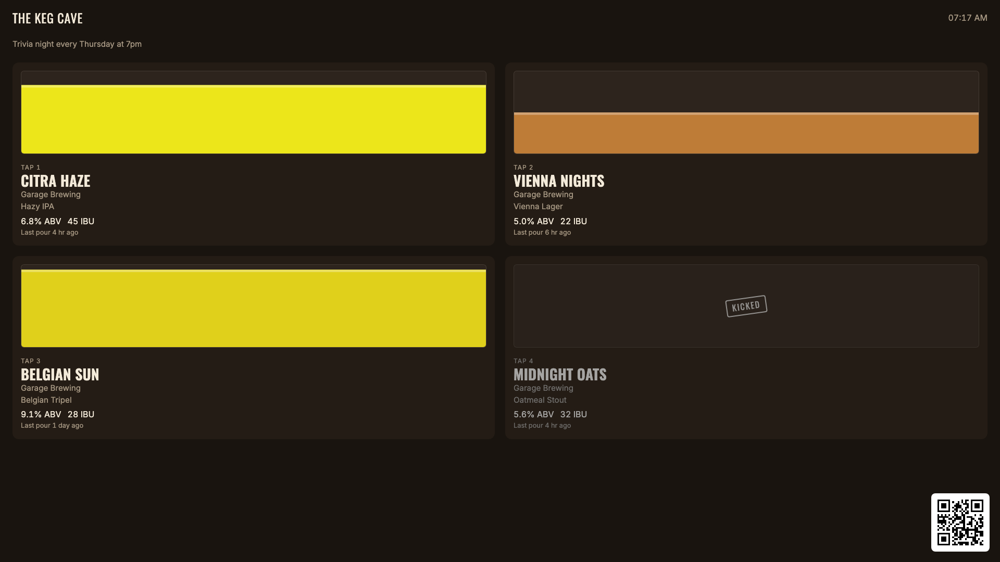
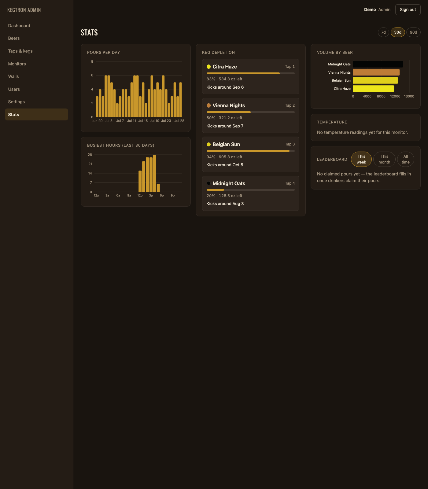

# Kegwall

[](https://github.com/dlommm/Kegwall/-/pipelines)
[](https://github.com/dlommm/Kegwall/-/releases)
[](LICENSE)

A self-hosted, PourWall-style digital tap wall for [Kegtron](https://kegtron.com) keg
monitors — live keg levels, beer metadata, and pour animation on any TV browser. It's
**standalone-first**: it runs fully on its own, with an entirely optional Home Assistant
integration on top. One Docker image, one SQLite database, no cloud account required to
operate (only to talk to Kegtron's own hardware API).

Where [PourWall](https://pourwall.info)'s Kegtron integration only syncs keg level percent,
this app pulls full metadata — beer name, brewery, style, ABV, IBU, temperature, pour
history — and layers on live pour animation (from Kegtron's local UDP stream), alerts,
automations, and deep wall customization.



## Screenshots

| Admin stats | Mobile QR menu |
|---|---|
|  |  |

## What it does

- **Ingests from both Kegtron hardware lines** — Pro (cloud REST + WebSocket, plus optional
  local UDP multicast for sub-second pour updates) and Gen 1 KT-100/KT-200 (direct
  Bluetooth LE, or via an MQTT bridge for devices out of range). Optional
  [Govee](https://govee.com) cloud sensors add named ambient-temperature chips to the wall
  header, with a cross-sensor spread warning.
- **The wall — a full look library × 10 themes.** Every wall picks a *look* (Classic grid, Ledger,
  Gallery, Tap columns, Chalkboard, Editorial, Neon Arcade, Terminal, Poster, Departures,
  Zen) and a color *theme*, with dynamic SVG data glyphs (style-matched SRM glassware,
  IBU hop cone, ABV strength glasses, keg-type level silhouettes — or a photorealistic keg
  cutaway fill), NEW ON TAP / ALMOST GONE / POURING badges, an announcement line, footer
  ticker, in-chrome menu QR, and a raw custom-CSS escape hatch.
- **Pour takeover** — when someone pours, the wall reacts live: Full screen, Spotlight row,
  Split panel, Bottom dock, or Screen fill modes with a real-time counter fed by Kegtron's
  UDP stream, a configurable trigger volume, and a pour-complete splash.
- **View rotation + paired displays** — a per-wall playlist (wall / leaderboard) cycles on
  the TV with a position bar, big tap lists auto-chunk into pages, and a live pour always
  interrupts back to the wall. Physical screens pair once with a short code at `/display`
  and from then on render their assigned wall; multi-room setups get first-class
  **locations** that scope taps, walls, and the admin views.
- **Who's pouring** — a kegerator tablet kiosk (`/tablet/:slug`) with passwordless avatar
  sign-in arms a pourer before they pour; pours attribute automatically, earn a 0–100
  flow-consistency quality score, and feed a public leaderboard (`/board`) with
  superlatives. Drinkers can also claim pours from the QR menu, rate the beer afterward
  (5-star + quick tags), build a personal passport (volume, styles, badges), and group
  taps into a live session with a recap.
- **Admin UI** — a sidebar shell with three admin looks (Midnight Slate, Workshop,
  Console), ⌘K quick-nav, live dashboard (stat cards, real-SRM tap rows, source health,
  activity feed), keg cards with "kicks in ~N days" forecasts and line-cleaning reminders,
  beers (Open Brewery DB lookup, offline BJCP-style autocomplete, optional catalog.beer
  search, auto-import of beers seen on Kegtron devices), guided keg swaps, multi-user
  roles, a unified filterable Logs page with live tail and export, an Analytics page (KPI
  row incl. cost/pint and value-on-tap, busiest-hours heatmap, full JSON export), and a
  connection doctor that live-tests the cloud + UDP path.
- **Alerts + automations** — a rule engine (keg-low, kicked, temperature, offline source,
  scheduled...) with delivery over in-app notifications, ntfy/Pushover, email (SMTP),
  Discord/Slack webhooks, and MQTT — plus a notification center and one-click templates.
- **Optional Home Assistant integration** — publishes tap and monitor sensors via MQTT
  discovery (entities appear automatically, no HA YAML) and two event topics for pour/alert
  automations. The app works completely without it.
- **Backup + recovery** — one-click backup download and staged restore from the admin UI,
  with a documented manual recovery path if a restore ever goes wrong.

## Current limitations (read before you rely on this)

- **catalog.beer beer search is optional and limited.** It's a bring-your-own-API-key
  integration (Settings → Integrations) — nothing is searchable until you set one.
  catalog.beer's own coverage is roughly 60,000 beers (far short of Untappd's catalog),
  it has no label-art field at all (search results never include an image — add a label
  separately after picking a result), and its free tier caps out at 1,000 requests/month,
  which is why the search box only fires on submit (Enter/button), never per keystroke.
- **Gen 1 MQTT payload shape is unverified against real hardware.** Theengs Decoder has no
  built-in Kegtron device profile, so the MQTT-bridge parser is a documented best-effort
  inference (not a confirmed real-world payload) — see
  [docs/install/esp32-gen1.md](docs/install/esp32-gen1.md) for the exact accepted keys and
  how to check your bridge's output against them. The **direct-BLE** path for Gen 1 devices
  (no MQTT bridge needed) *is* a byte-exact port of a real, verified parser and is the
  preferred route if you can put the app within Bluetooth range — see
  [docs/install/raspberry-pi.md](docs/install/raspberry-pi.md#direct-ble-setup-gen-1-devices).
- **No Secure flag on the session cookie.** Deliberate, for plain-HTTP LAN deployments —
  see [docs/install/docker.md#reverse-proxy-and-https](docs/install/docker.md#reverse-proxy-and-https)
  before exposing this beyond a trusted LAN.
- **Raspberry Pi bare-metal and direct-BLE steps are unverified against physical hardware**
  (no Pi or real Kegtron Gen 1 device was available while writing these docs) — the Docker
  path *was* built and boot-tested live. Flagged explicitly in the Pi doc itself.
- **On the backlog, not started:** native TV apps (Android TV / Apple TV — browser + kiosk
  mode covers all TVs today) and two-way beer-metadata sync back to Kegtron's cloud (import
  is one-way in this version).

## Quickstart (Docker)

Published images live in this repo's container registry —
`ghcr.io/dlommm/kegwall` — tagged `latest` plus each release version
(`0.5.0`, ...), multi-arch (amd64 + arm64).

```sh
docker run -d --name kegwall \
  -p 8080:8080 \
  -v kegwall-data:/data \
  --restart unless-stopped \
  ghcr.io/dlommm/kegwall:latest
```

Or with Compose (also see [deploy/docker-compose.unraid.yml](deploy/docker-compose.unraid.yml)
for an Unraid-ready file):

```sh
git clone https://github.com/dlommm/Kegwall.git
cd kegwall/deploy
docker compose up -d
```

Open `http://localhost:8080` — first visit takes you to a one-time admin setup screen
(there is no default login). That's it; everything else (Kegtron API key, MQTT, alert
channels, walls...) is configured from the admin UI's Settings page. Full reference —
environment variables, bridge vs. host networking (needed for Kegtron's UDP broadcast or
direct BLE), reverse proxy/HTTPS, and backup/updating — is in
[docs/install/docker.md](docs/install/docker.md).

## Documentation

| Doc | Covers |
|---|---|
| [docs/install/docker.md](docs/install/docker.md) | Docker/NAS install, env vars, networking modes, reverse proxy + HTTPS, backups |
| [docs/install/raspberry-pi.md](docs/install/raspberry-pi.md) | Docker or bare-metal on a Pi, direct-BLE setup, kiosk-mode wall display |
| [docs/install/esp32-gen1.md](docs/install/esp32-gen1.md) | Gen 1 (KT-100/KT-200) via an ESP32 BLE-to-MQTT bridge, incl. the payload-shape caveat above |
| [docs/setup/kegtron-cloud.md](docs/setup/kegtron-cloud.md) | Kegtron Pro API key + optional UDP for faster local updates |
| [docs/setup/home-assistant.md](docs/setup/home-assistant.md) | MQTT discovery, entities published, event topics for automations |
| [docs/recovery.md](docs/recovery.md) | Backup, restore, and manual crash-loop recovery |
| [docs/customization.md](docs/customization.md) | Wall layout, themes, custom CSS trust model, screensaver |

## Tech stack

Single Node 22 / TypeScript process (ESM, strict): Fastify (REST + WebSocket + static
files), better-sqlite3 (WAL mode, embedded migrations), React 18 for the web frontend.
No separate server build step — the server runs its TypeScript source directly under
`tsx`; only the SPA is compiled ahead of time (`vite build`). See
[docs/superpowers/specs/2026-07-27-kegtron-dashboard-design.md](docs/superpowers/specs/2026-07-27-kegtron-dashboard-design.md)
for the full architecture writeup.

## Continuous integration

[`.gitlab-ci.yml`](.gitlab-ci.yml) runs typecheck, the unit suite, and the web build on
every push. Pushing a `v*` tag additionally builds the multi-arch (amd64 + arm64) image,
pushes it to the container registry as both `X.Y.Z` and `latest` (`latest` never moves on
a prerelease tag), and creates a GitLab Release for the tag.

## Running from source (without Docker)

```sh
npm ci
npm run build
npm start
```

Requires Node >= 22 and a C++ toolchain for better-sqlite3's native build (see
[docs/install/raspberry-pi.md#bare-metal-path](docs/install/raspberry-pi.md#bare-metal-path)
for the exact packages on Debian/Raspberry Pi OS). `npm run dev` runs the server under
`tsx watch` plus a separate `npm run dev:web` Vite dev server for frontend work.

```sh
npm test          # unit suite (Vitest)
npm run typecheck # tsc --noEmit, server + web projects
npm run test:e2e  # Playwright, against a production build
```

## Contributing

No formal process yet — this is a young project. Bug reports and merge requests are
welcome; for anything nontrivial, opening an issue first to discuss the approach is
appreciated. Run the full local gate before sending an MR:

```sh
npm test && npm run typecheck && npm run build && npm run test:e2e
```

## License

MIT — see [LICENSE](LICENSE). Full changelog: [CHANGELOG.md](CHANGELOG.md).
