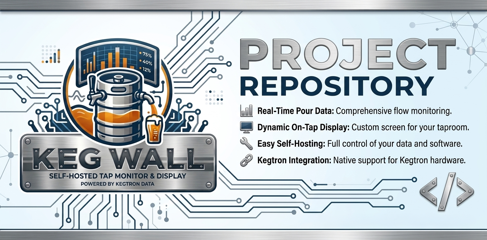
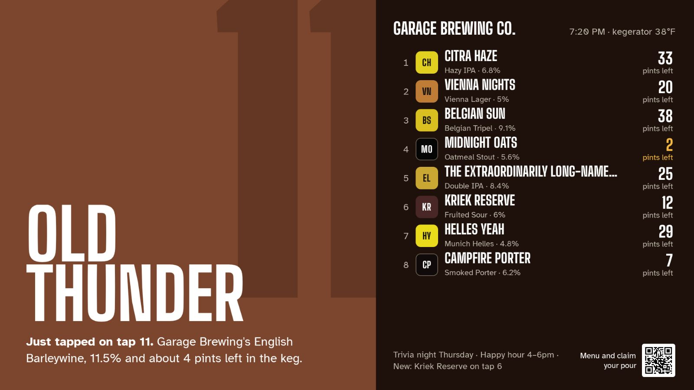
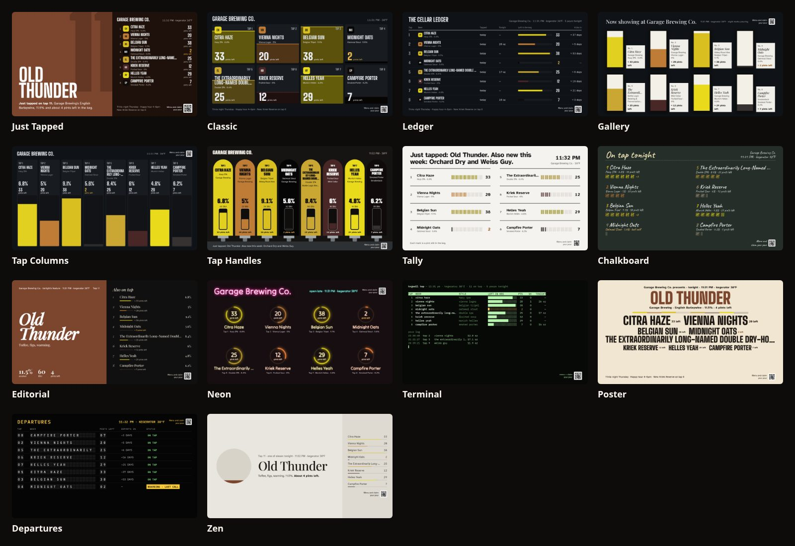
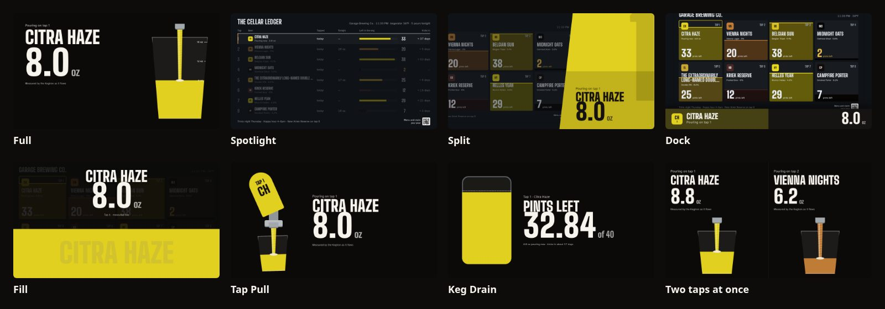
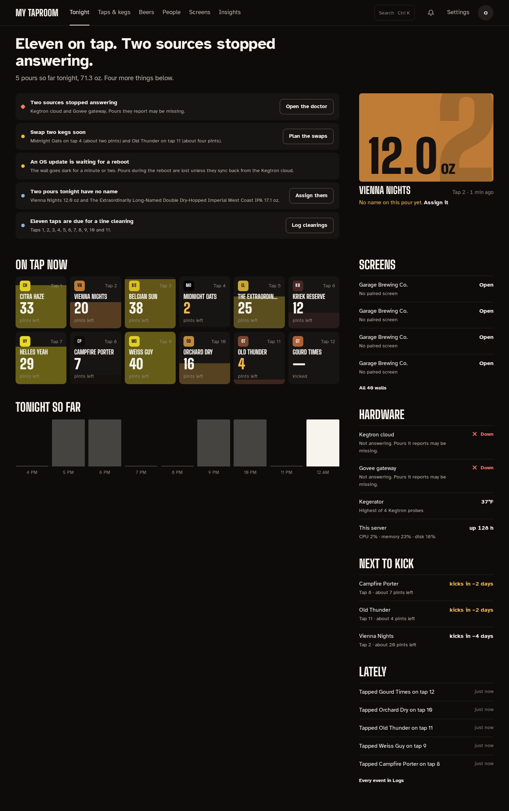
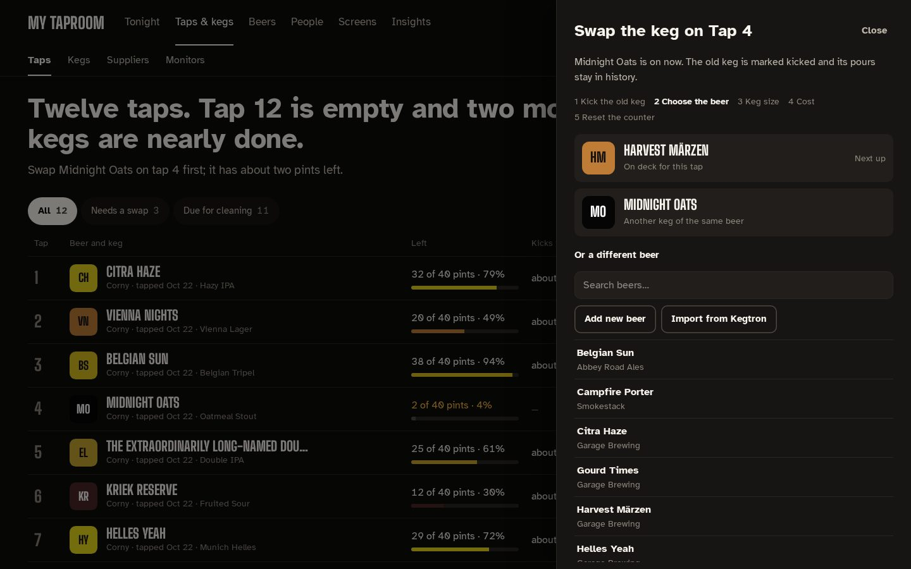
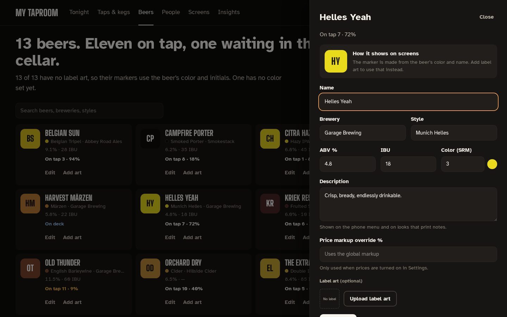
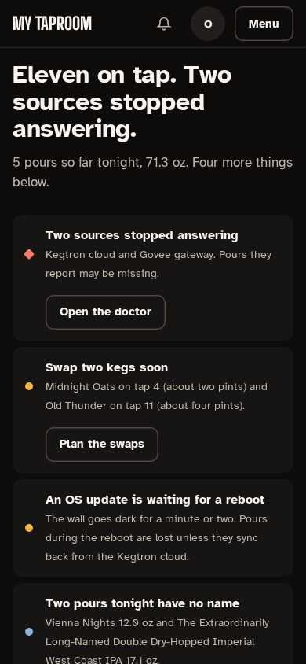
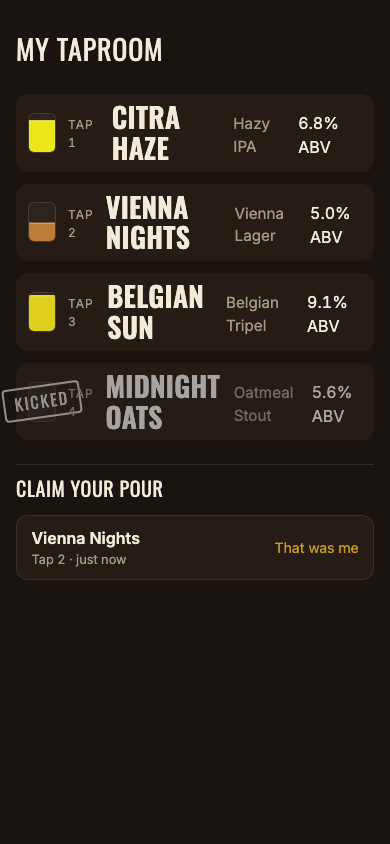

# Kegwall

[](https://github.com/dlommm/Kegwall/actions/workflows/release.yml)
[](https://github.com/dlommm/Kegwall/releases)
[](LICENSE)

A self-hosted, PourWall-style digital tap wall for [Kegtron](https://kegtron.com) keg
monitors — live keg levels, beer metadata, and pour animation on any TV browser. It's
**standalone-first**: it runs fully on its own, with an entirely optional Home Assistant
integration on top. One Docker image, one SQLite database, no cloud account required to
operate (only to talk to Kegtron's own hardware API).

Where [PourWall](https://pourwall.info)'s Kegtron integration only syncs keg level percent,
this app pulls full metadata — beer name, brewery, style, ABV, IBU, temperature, pour
history — and layers on live pour animation (from Kegtron's local UDP stream), alerts,
automations, and deep wall customization.



## Screenshots

**Fourteen wall looks**, each in ten color themes, and every one shows what's left in each keg as
a picture and in pints:



**Pour takeovers** react live while someone pours, counting the volume as Kegtron measures it,
with a lane per tap when several pour at once:



**The admin** opens on Tonight: what needs doing, the last pour, every tap's level, pours by hour
and the hardware.



| Taps, with the keg swap drawer | The beer library and editor |
|---|---|
|  |  |
| **Tonight on a phone** | **Phone QR menu** |
|  |  |

## What it does

- **Ingests from both Kegtron hardware lines** — Pro (cloud REST + WebSocket, plus optional
  local UDP multicast for sub-second pour updates) and Gen 1 KT-100/KT-200 (direct
  Bluetooth LE, or via an MQTT bridge for devices out of range). Optional
  [Govee](https://govee.com) cloud sensors add named ambient-temperature chips to the wall
  header, with a cross-sensor spread warning.
- **The wall — 14 looks × 10 themes.** Every wall picks a *look* (Just Tapped, Classic, Ledger,
  Gallery, Tap Columns, Tap Handles, Tally, Chalkboard, Editorial, Neon, Terminal, Poster,
  Departures, Zen) and a color *theme*. Every look shows what's left twice: a picture readable
  across the room and **pints left** in your serving size. Each beer gets a tap marker in its own
  color (or its label art), and walls carry sentence headlines from live data, tonight's pours,
  the kick forecast, the public price when pricing is on, an announcement line, a menu QR, and a
  raw custom-CSS escape hatch. Looks render on a fixed 1920 × 1080 layout, so 720p, 1080p and 4K
  TVs show the same composition.
- **Pour takeover** — when someone pours, the wall reacts live: Full, Spotlight, Split, Dock,
  Fill, Tap Pull, Keg Drain, Game On or Badge, with a real-time counter fed by Kegtron's UDP
  stream, a lane per tap when several pour at once, an optional **Cheers** finish, and opt-in
  wall moments (just kicked, just tapped, pour milestones).
- **View rotation + paired displays** — a per-wall playlist (wall / leaderboard) cycles on
  the TV with a position bar, big tap lists auto-chunk into pages, and a live pour always
  interrupts back to the wall. Physical screens pair once with a short code at `/display`
  and from then on render their assigned wall. Multi-room setups assign **Kegtron
  devices to walls**: monitors group into physical devices (a 4-port Kegtron is one
  device with four bindable ports, one temperature sensor, one admin card), and each
  wall shows exactly the taps fed by its assigned devices.
- **Who's pouring** — a kegerator tablet kiosk (`/tablet/:slug`) with passwordless avatar
  sign-in arms a pourer before they pour; pours attribute automatically, earn a 0–100
  flow-consistency quality score, and feed a public leaderboard (`/board`) with
  superlatives. Drinkers can also claim pours from the QR menu, rate the beer afterward
  (5-star + quick tags), build a personal passport (volume, styles, badges), and group
  taps into a live session with a recap.
- **Face sign-in (optional)** — enrolled drinkers can skip hunting for their avatar:
  the tablet recognizes a returning face entirely on-device and offers a one-tap
  "You pouring, NAME?" confirm before arming their pour. Off by default, opt-in per
  drinker, and deletable any time — see [docs/setup/face-sign-in.md](docs/setup/face-sign-in.md).
- **Admin UI** — one design, dark or light with your device, with a top bar of six
  destinations (Tonight, Taps & kegs, Beers, People, Screens, Insights), Ctrl K / ⌘K search and
  a phone menu. It opens on **Tonight**: what needs doing, grouped one row per kind, the last
  pour, every tap's level, pours by hour, hardware state and the next kegs to kick. Taps show
  servings left and kick forecasts, keg swaps run in a guided drawer, and line-cleaning
  reminders skip empty taps and can be ignored per tap. Beer library, keg costs and suppliers,
  multi-user roles, filterable live logs, analytics exports and a connection doctor round it
  out; see [docs/admin-dashboard.md](docs/admin-dashboard.md),
  [docs/taps-and-kegs.md](docs/taps-and-kegs.md) and [docs/beers.md](docs/beers.md).
- **Alerts + automations** — a rule engine (keg-low, kicked, temperature, offline source,
  scheduled...) with delivery over in-app notifications, ntfy/Pushover, email (SMTP),
  Discord/Slack webhooks, and MQTT — plus a notification center and one-click templates.
- **Optional Home Assistant integration** — publishes tap and monitor sensors via MQTT
  discovery (entities appear automatically, no HA YAML) and two event topics for pour/alert
  automations. The app works completely without it.
- **Display power control** — motion wakes displays, idle stages into a screensaver, older
  idle turns displays off completely. The **Displays & Presence** admin hub configures
  motion sources (GPIO PIR/mmWave, BLE BTHome beacons like Shelly BLU Motion, MQTT/
  zigbee2mqtt, or an HA webhook — see [docs/setup/motion-sensors.md](docs/setup/motion-sensors.md)
  for the hardware buying/wiring guide) alongside per-wall timing and a live zone/agent
  overview. The [display agent](docs/install/display-agent.md) is a zero-dependency
  script (bash + curl) that runs real screen on/off commands: HDMI-CEC for TVs, DPMS for
  X11 kiosks, or backlight control for Pi touchscreens.
- **Backup + recovery** — one-click backup download and staged restore from the admin UI,
  with a documented manual recovery path if a restore ever goes wrong.

## Current limitations (read before you rely on this)

- **catalog.beer beer search is optional and limited.** It's a bring-your-own-API-key
  integration (Settings → Integrations) — nothing is searchable until you set one.
  catalog.beer's own coverage is roughly 60,000 beers (far short of Untappd's catalog),
  it has no label-art field at all (search results never include an image — add a label
  separately after picking a result), and its free tier caps out at 1,000 requests/month,
  which is why the search box only fires on submit (Enter/button), never per keystroke.
- **Gen 1 MQTT payload shape is unverified against real hardware.** Theengs Decoder has no
  built-in Kegtron device profile, so the MQTT-bridge parser is a documented best-effort
  inference (not a confirmed real-world payload) — see
  [docs/install/esp32-gen1.md](docs/install/esp32-gen1.md) for the exact accepted keys and
  how to check your bridge's output against them. The **direct-BLE** path for Gen 1 devices
  (no MQTT bridge needed) *is* a byte-exact port of a real, verified parser and is the
  preferred route if you can put the app within Bluetooth range — see
  [docs/install/raspberry-pi.md](docs/install/raspberry-pi.md#direct-ble-setup-gen-1-devices).
- **No Secure flag on the session cookie.** Deliberate, for plain-HTTP LAN deployments —
  see [docs/install/docker.md#reverse-proxy-and-https](docs/install/docker.md#reverse-proxy-and-https)
  before exposing this beyond a trusted LAN.
- **Face sign-in embeddings are readable on the trusted LAN, unauthenticated.** Same
  trust class as the pourer avatar grid — nothing you wouldn't want any device on your
  network able to read. It's opt-in, embeddings-only (raw camera frames never reach the
  server), and deletable any time by the drinker or an admin — see
  [docs/setup/face-sign-in.md](docs/setup/face-sign-in.md).
- **Raspberry Pi bare-metal and direct-BLE steps are unverified against physical hardware**
  (no Pi or real Kegtron Gen 1 device was available while writing these docs) — the Docker
  path *was* built and boot-tested live. Flagged explicitly in the Pi doc itself.
- **Browser soft-off (screensaver / black screen) cannot cut an LED TV's backlight by itself.**
  Real power-off requires one of three paths: the [display agent](docs/install/display-agent.md)
  (zero-dependency bash script for Pi/CEC/Wayland kiosks), Home Assistant automations
  subscribing to `kegwall/event/display_power`, or a server-side automation rule triggering
  a Fully Kiosk webhook (for Android tablets).
- **On the backlog, not started:** native TV apps (Android TV / Apple TV — browser + kiosk
  mode covers all TVs today) and two-way beer-metadata sync back to Kegtron's cloud (import
  is one-way in this version).

## Quickstart (Docker)

Published images live in the GitHub Container Registry —
`ghcr.io/dlommm/kegwall` — tagged `latest` plus each release version
(`0.5.0`, ...), multi-arch (amd64 + arm64).

```sh
docker run -d --name kegwall \
  -p 8080:8080 \
  -v kegwall-data:/data \
  --restart unless-stopped \
  ghcr.io/dlommm/kegwall:latest
```

Or with Compose (also see [deploy/docker-compose.unraid.yml](deploy/docker-compose.unraid.yml)
for an Unraid-ready file):

```sh
git clone https://github.com/dlommm/Kegwall.git kegwall
cd kegwall/deploy
docker compose up -d
```

Open `http://localhost:8080` — first visit takes you to a one-time admin setup screen
(there is no default login). That's it; everything else (Kegtron API key, MQTT, alert
channels, walls...) is configured from the admin UI's Settings page. Full reference —
environment variables, bridge vs. host networking (needed for Kegtron's UDP broadcast or
direct BLE), reverse proxy/HTTPS, and backup/updating — is in
[docs/install/docker.md](docs/install/docker.md).

## Documentation

Start at the **[docs index](docs/README.md)** — it maps every guide. The
[GitHub Wiki](https://github.com/dlommm/Kegwall/wiki) mirrors the same material
for browsing, and [CHANGELOG.md](CHANGELOG.md) describes every released version.

| Doc | Covers |
|---|---|
| [docs/install/docker.md](docs/install/docker.md) | Docker/NAS install, env vars, networking modes, reverse proxy + HTTPS, backups |
| [docs/install/raspberry-pi.md](docs/install/raspberry-pi.md) | Docker or bare-metal on a Pi, direct-BLE setup, kiosk-mode wall display |
| [docs/install/mini-pc.md](docs/install/mini-pc.md) | Native install on an amd64 mini PC / Intel NUC (Debian 13), no Docker |
| [docs/install/unattended-debian.md](docs/install/unattended-debian.md) | Turnkey amd64 installer ISO — flash a USB, boot, SSH in; unattended Debian + Kegwall |
| [docs/install/native-wall.md](docs/install/native-wall.md) | Native flutter-pi wall client (vs chromium kiosk) + how to tell which mode a screen runs |
| [docs/install/esp32-gen1.md](docs/install/esp32-gen1.md) | Gen 1 (KT-100/KT-200) via an ESP32 BLE-to-MQTT bridge, incl. the payload-shape caveat above |
| [docs/install/android-tablet.md](docs/install/android-tablet.md) | The Android kiosk APK for the kegerator tablet (built by CI, sideloaded) |
| [docs/install/display-agent.md](docs/install/display-agent.md) | Zero-dependency agent for real screen power-off (DPMS/backlight) driven by presence |
| [docs/setup/kegtron-cloud.md](docs/setup/kegtron-cloud.md) | Kegtron Pro API key + optional UDP for faster local updates |
| [docs/setup/home-assistant.md](docs/setup/home-assistant.md) | MQTT discovery, entities published, event topics for automations |
| [docs/setup/motion-sensors.md](docs/setup/motion-sensors.md) | Motion sensor buying/wiring guide — mmWave, PIR/GPIO, BLE (Shelly BLU Motion), Zigbee via zigbee2mqtt, HA webhook |
| [docs/setup/face-sign-in.md](docs/setup/face-sign-in.md) | On-device browser face matching for tablet sign-in, privacy model, enable/enroll/delete flow |
| [docs/recovery.md](docs/recovery.md) | Backup, restore, and manual crash-loop recovery |
| [docs/customization.md](docs/customization.md) | The 14 wall looks, themes, pour takeovers and wall moments, custom CSS trust model, screensaver |
| [docs/admin-dashboard.md](docs/admin-dashboard.md) | Tonight, the admin top bar, Search and phone navigation |
| [docs/taps-and-kegs.md](docs/taps-and-kegs.md) | Taps, swapping a keg, keg costs, monitors |
| [docs/people.md](docs/people.md) | Pourers, accounts and roles |
| [docs/beers.md](docs/beers.md) | The beer library and editor |
| [docs/suppliers.md](docs/suppliers.md) | Suppliers, opening hours and the price book |
| [docs/cleaning-and-pours.md](docs/cleaning-and-pours.md) | Line-cleaning reminders and unclaimed pours |

## Tech stack

Single Node 24 / TypeScript process (ESM, strict): Fastify (REST + WebSocket + static
files), better-sqlite3 (WAL mode, embedded migrations), React 19 for the web frontend.
No separate server build step — the server runs its TypeScript source directly under
`tsx`; only the SPA is compiled ahead of time (`vite build`). See the
[documentation index](docs/README.md) for feature, install, and integration guides.

## Continuous integration & automated releases

GitHub Actions ([`.github/workflows/`](.github/workflows/)) runs typecheck, the unit suite, and
the web build on every push and pull request. Releases are fully automated: pushes to `main` run
[semantic-release](https://semantic-release.gitbook.io/) (config in
[`.releaserc.json`](.releaserc.json)), which reads
[conventional commit](https://www.conventionalcommits.org/) messages to pick the next
version (`fix:` → patch, `feat:` → minor, `BREAKING CHANGE:`/`!` → major), updates
`CHANGELOG.md` + `package.json`, pushes the `vX.Y.Z` tag, and creates a GitHub Release
with generated notes. The same run then builds the multi-arch (amd64 + arm64) image and
pushes it to `ghcr.io/dlommm/kegwall` as both `X.Y.Z` and `latest` (`latest` never moves on
a prerelease tag), and attaches the tablet APK and the unattended-installer ISO to the
release. Merging a `feat:`/`fix:` commit is the entire release process — commit messages are
the release notes, so write them accordingly. Everything runs on the built-in
`GITHUB_TOKEN`; the only secrets to configure are the optional `ANDROID_KEYSTORE_*` ones for a
stably-signed APK (see [docs/install/android-tablet.md](docs/install/android-tablet.md)).

## Running from source (without Docker)

```sh
npm ci
npm run build
npm start
```

Requires Node >= 22 and a C++ toolchain for better-sqlite3's native build (see
[docs/install/raspberry-pi.md#bare-metal-path](docs/install/raspberry-pi.md#bare-metal-path)
for the exact packages on Debian/Raspberry Pi OS). `npm run dev` runs the server under
`tsx watch` plus a separate `npm run dev:web` Vite dev server for frontend work.

```sh
npm test          # unit suite (Vitest)
npm run typecheck # tsc --noEmit, server + web projects
npm run test:e2e  # Playwright, against a production build
```

## Contributing

No formal process yet — this is a young project. Bug reports and pull requests are
welcome; for anything nontrivial, opening an issue first to discuss the approach is
appreciated. See [CONTRIBUTING.md](CONTRIBUTING.md) for the full workflow. Run the full
local gate before opening a pull request:

```sh
npm test && npm run typecheck && npm run build && npm run test:e2e
```

**Docs are part of every change.** A change that adds, removes, or alters a user-visible
feature, install step, or setting must update the docs in the same commit:

- The **[`docs/`](docs/README.md)** page(s) for the area you touched (and the docs index if you
  add a page).
- The **[Wiki](https://github.com/dlommm/Kegwall/wiki)** page mirroring it.
- **[CHANGELOG.md](CHANGELOG.md)** — carried by your conventional-commit message
  (`feat:`/`fix:` become the release notes), so write the commit subject as the changelog line.

A pull request that changes behaviour without touching docs is incomplete.

## License

MIT — see [LICENSE](LICENSE). Full changelog: [CHANGELOG.md](CHANGELOG.md).
