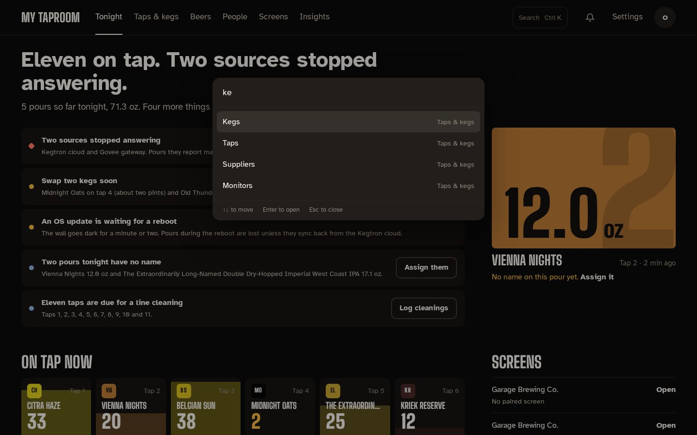
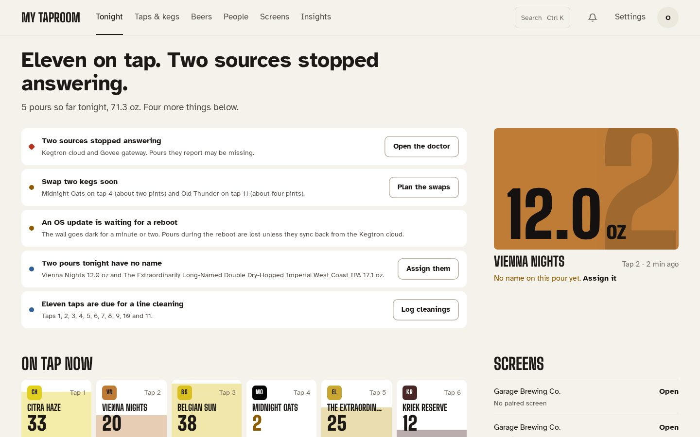
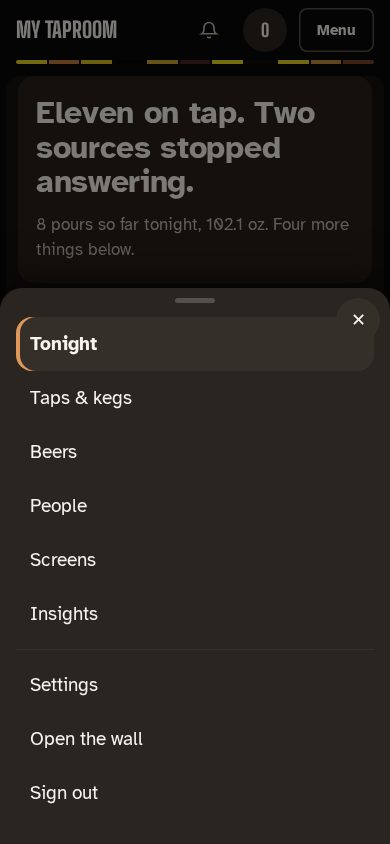

# Tonight and admin navigation

The admin opens on **Tonight**: a sentence about the night ("Eleven on tap. Two kegs need a swap
soon.") and a line with tonight's pours and volume. Tonight is the service day, from 4 am to 4 am,
so a pour at 1 am still counts as tonight.

The admin sits on a dark frame with each page on a lighter sheet, and each block of a page on
its own panel. A 4 px strip under the top bar shows the colours of the beers on tap, in tap
order, and every page opens on a faint copper band holding its sentence. Copper is kept for the
one main action on a screen and for what is happening now (the current hour, a pour in
progress). Light mode follows the same layers.

**Needs attention** lists what needs doing, one row per kind of problem, each with one action.
Problems come first (red diamond, a red edge and a larger title), then cautions (amber edge), then
information (blue, as plain ruled lines):

| Row | When it shows | Action |
|---|---|---|
| Power | The Pi is, or was since it started, short of power | None; the row says to use the official power supply |
| Sources stopped answering | A configured source (Kegtron cloud, UDP, Govee, …) is down; several fold into one row | Open the doctor |
| Swap kegs soon | Kegs at or below 15 %, with about how many pints are left | Plan the swaps |
| OS update waiting | An OS update needs a reboot | Reboot now (asks you to confirm), when Kegwall manages the OS |
| Pours with no name | Tonight's pours nobody claimed, only when you have pourers | Assign them |
| Line cleaning | Taps due for a cleaning, all in one row | Log cleanings |
| No tap wall yet | A fresh install with no wall | Finish setting up |

Taps whose line-cleaning reminders are off are listed in a short note under the list (see
[Cleaning reminders and unclaimed pours](cleaning-and-pours.md)).

Beside the list, the **last pour** shows its volume on the beer's color, the beer, the tap and
how long ago, with **Assign it** when nobody has claimed it.

**On tap now** shows every tap as a glass filled to its level in the beer's own color with a
foam line on top, the tap number set large behind it, and the servings left. The words take dark
or light ink depending on whether the beer or the empty glass is behind them. A low keg gets an
amber edge and count, a kicked tap is an empty outline, and a stout keeps a warm rim so it shows
on the dark page. Select one to open it under Taps & kegs. **Tonight so far** charts pours per
hour from 4 pm (or the first pour), with each hour's count over its bar and the current hour in
copper.

The side column shows:

- **Screens**: paired displays (on, last seen, or not paired), or your walls when no display is
  paired, at most four with a link to the rest;
- **Hardware**: each configured source's state, the kegerator (the warmest Kegtron probe), each
  Govee sensor, and this server's CPU, memory, disk and temperature;
- **Next to kick**: the three kegs projected to run out first. A nearly empty keg with no
  recent pours has no pace to project from, so it shows as "almost out";
- **Lately**: the five latest events, with a link to Logs.

Tonight never shows keg cost.

## Getting around

The admin has one top bar and no sidebar. From the left:

- your taproom's name, which takes you back to Tonight;
- six destinations: **Tonight**, **Taps & kegs**, **Beers**, **People**, **Screens** and
  **Insights**;
- **Search** (or **Ctrl K** / **⌘K** from anywhere) to jump to any page, or to a tap by its
  number or beer ("oat" finds Tap 4 · Midnight Oats, with what's left and the beer's color); use
  the arrow keys and **Enter**, or **Escape** to close;
- the notification bell, with the number of unread notifications. Its panel opens with a sentence
  ("Two need you." or "All caught up."), marks severity by shape as well as color (a diamond is
  critical, a triangle a warning), and closes with **Escape**;
- **Settings**;
- your account menu (your initials): your name and role, **Open the wall**, **Sign out** and the
  running Kegwall version.

When a destination has more than one page, its pages show as tabs under the top bar:

| Destination | Tabs |
|---|---|
| Tonight | the Tonight page (notifications are behind the bell) |
| Taps & kegs | Taps, Kegs, Suppliers, Monitors |
| Beers | the beer library |
| People | pourers and accounts (the page's own tabs) |
| Screens | Walls, Displays, Presence, Games |
| Insights | Analytics, Every pour, Logs |
| Settings | Settings, Automations, Home Assistant, Diagnostics |

Every address that worked before still works, including `/admin/users` and `/admin/pourers`,
which open under **People**. Pages only admins may open (Kegs, Suppliers, Presence, Settings and
accounts) are hidden from editors and viewers in the bar, the tabs and Search; for them,
**Settings** opens Automations.

Every admin page shows its own title, and the browser tab is named after the current section (for
example "Pours · Kegwall"), so several open admin tabs stay easy to tell apart.

## One look, light or dark

The admin has a single design. It is dark by default and switches to its light counterpart when
your device is set to a light appearance.

 The old **Appearance** choice (Midnight Slate, Workshop,
Console) has been removed; a choice saved in a browser is ignored.

## Phones and tablets

| Tonight on a phone | The phone menu |
|---|---|
|  |  |

On narrow screens the destinations move into **Menu** at the top right, which opens them as a
sheet along with Settings, **Open the wall** and **Sign out**. The sheet closes when you choose a
page, press **Escape** or tap outside it. Every control in the bar and the sheet is at least 44 px
tall.
