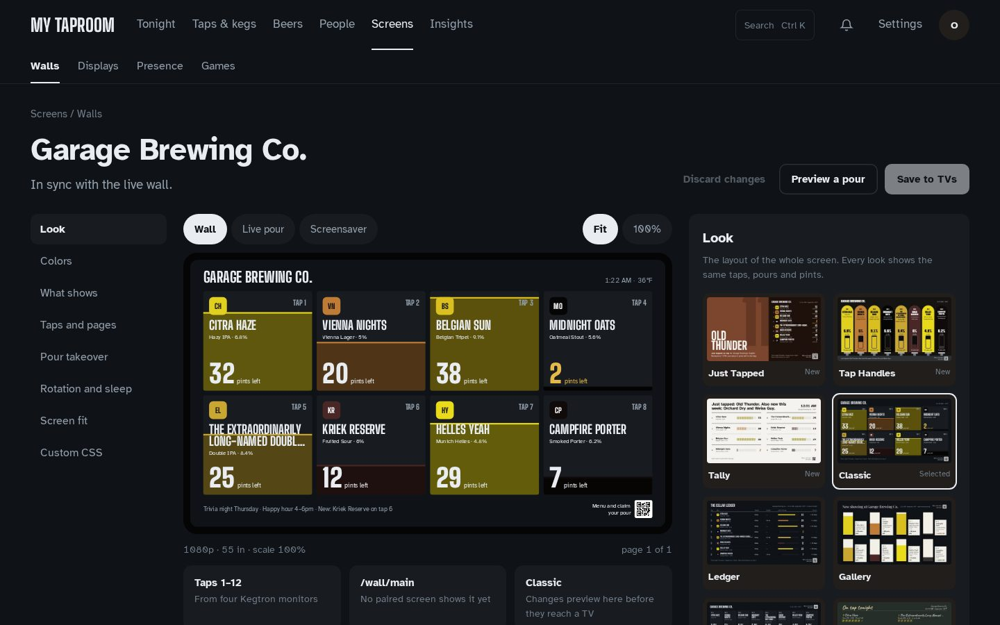

# Customizing walls

A "wall" is a public, unauthenticated display page (`/wall/:slug`) meant for a TV or
kiosk display. Everything below is configured per wall in the admin's **Wall Editor**:
**Screens → Walls → Edit wall** (editor role or higher). This doc explains what each option
actually does, sourced from the wall config schema (`src/server/core/wallConfig.ts`).

## The Wall Editor

The editor is a studio in three parts:

- **A rail of eight sections** on the left: Look, Colors, What shows, Taps and pages, Pour
  takeover, Rotation and sleep, Screen fit, Custom CSS. A dot marks every section with unsaved
  changes; **Undo** in a section puts just that section back, **Discard changes** puts back
  everything.
- **A live 16:9 stage** in the middle, drawn from the draft with **this wall's own taps** (the
  taps on the monitors it's assigned). Switch it between **Wall**, **Live pour** (a pour held
  half-way in the chosen takeover style) and **Screensaver**, between **Fit** and **100%**, and
  between pages. **Preview a pour** plays one whole pour; nothing is recorded. Under the stage:
  which taps the wall shows, which paired screens get it on save, and the spotlight.
- **The inspector** on the right: the 14-look gallery, theme swatches (individual colors under
  a disclosure), plain fields elsewhere, and custom CSS checked before it saves.

Nothing reaches a TV until **Save to TVs**. Leaving with unsaved changes asks first.

## Looks

A wall's **look** is its whole layout. Kegwall 2.0 redraws the looks so a wall reads like a
taproom board rather than a dashboard. Every redrawn look:

- shows each beer's real color (from its SRM) and a **tap marker**: the beer's color, its
  initials and its tap number. Uploaded label art replaces the initials;
- states what's left **twice**: as a picture (a fill, a bar, a plate) and in servings, for
  example "≈ 32 pints left". Servings use **Settings → Site → Serving size**: a pint-sized
  serving (440–600 mL) reads as pints, anything else as pours;
- is drawn on a fixed 1920 × 1080 layout scaled to the screen, so a 720p, 1080p or 4K TV
  shows the same composition (letterboxed in the theme's background if the screen isn't
  16:9). **Display fit → UI scale** still enlarges the type;
- uses the Kegwall type (Big Shoulders Display and Atkinson Hyperlegible) whatever the
  theme's own fonts are, and picks text colors that meet WCAG contrast in every theme.

| Look | What it is | Taps per page |
| --- | --- | --- |
| `just-tapped` (**default for new walls**) | The spotlight keg owns half the screen as a field of its own color, with its tap number set huge. The rest are listed beside it with pints left. Kicked kegs move to a sentence in the footer | 12 |
| `classic` | Every card is its keg, filled from the bottom to the level, pints left as the big number. 1–4 taps show as large cards, 5–8 as two rows of cards, 9–12 as board rows | 12 |
| `ledger` | The cellar ledger: when each keg went on, what poured tonight, a level bar with pints left, and when it will kick | 12 |
| `columns` | Each column is the keg, filled in the beer's color | 8 |
| `gallery` | A museum wall: each beer a framed plate painted to its level, with a wall label | 8 |
| `handles` (new) | The bar back: each tap is a handle in its beer's color with a sight glass showing the level; a pouring handle tips forward. The drip tray carries the wall's headline sentence | 8 |
| `tally` (new) | A tally board: the night written as a sentence, each keg's remaining pints as tally marks (one mark = five pints for very large kegs) | 12 |
| `chalkboard` | The chalk menu: prices when you show them, pints left as chalk tally gates | 8 |
| `editorial` | A magazine feature on the spotlight keg, with the others as the contents page | 12 |
| `neon` | A wall of bar signs; each neon ring is drawn as far round as the keg is full | 8 |
| `terminal` | `top` for the taps: ASCII level bars, pours in the last hour, tonight's volume, the pour log | 12 |
| `poster` | A festival line-up: the spotlight keg headlines, the rest billed below with pints left | 12 |
| `departures` | A split-flap board: kegs sorted by when they'll kick; low kegs are boarding, kicked kegs have departed | 11 |
| `zen` | One beer at a time: the spotlight keg's orb holds what's left, with a quiet list beside it | 12 |

Just Tapped, Classic, Ledger, Columns and Gallery take their colors from the wall's theme.
The others are drawn in their own material (slate, paper, a black board, neon on brick) and
look the same whatever theme is picked. Editorial, Poster, Zen and Just Tapped feature the
**spotlight** keg.

**Spotlight**: by default the most recently tapped keg leads. Pin a tap to
keep one beer in the spotlight; if that tap is empty or kicked, the newest keg leads instead.

**Kick forecast and tonight.** "Tonight" counts pours since 4 am, so a late night stays one
night. The kick forecast divides what's left by the keg's pour rate over the last 7 days
(or since it was tapped, if that's sooner).

## Pour takeovers

When a tap pours past the wall's trigger (**Pour takeover → trigger**, 60 mL / about 2 oz by
default, so foam blips never flash the screen), the wall reacts in the chosen style:

| Style | What happens |
| --- | --- |
| `full` | The screen becomes the beer: its name, a large live counter, and a glass filling by measured volume over your serving size (8/12/16 oz marks on a pint), with a stream of beer from the spout. The head forms past half a glass and spills over at the finish |
| `spotlight` | The wall stays; every pouring row or card lifts and the rest dim |
| `split` | The wall slides aside and a panel in the beer's color rises with the counter |
| `dock` | A bar rises from the bottom and fills left to right; the wall lifts to make room |
| `fill` | The screen floods with the beer to the measured level, then drains |
| `off` (Badge) | Nothing moves: the pouring row shows "Pouring now · 8.0 oz" in the look itself |
| `tappull` | A giant handle in the beer's color swings forward on its pivot; the glass starts tilted, straightens as it fills, and slides off down the bar at the finish |
| `kegdrain` | The other side of the pour: the keg empties live, pints left count down to two decimals, a dashed line marks where the keg stood, with the kick forecast |
| `gameon` | Only while a drinking game runs: the standings stay up during the pour, and when it's recorded the pourer's bar moves and a new leader is called out. With no game running it behaves like `full` |

**Finish** — `Recorded volume` (default) or `Cheers`: a single full-screen pour (Full, Split,
Fill, Tap Pull, Keg Drain) ends with two glasses meeting, "Cheers, Alex", the recorded volume
and the pourer's passport pour number.

Keg Drain and Tap Pull show one pour; with several taps pouring they fall back to Full lanes.

### Wall moments

Opt in per wall (all off by default). Each takes the screen for about six seconds:

- **Just kicked** — a KICKED stamp slams down over the beer, and the next keg from the
  on-deck queue slides in.
- **Just tapped** — a curtain of the new beer's color wipes up and its name stamps in.
- **Pour milestones** — the house's every-100th pour, or a pourer's own 100th, 200th…, rolls
  over with a burst of rings.

A wall that shows the kicked or milestone moment skips the matching celebration banner.

Every style follows the same rules:

- **Several taps at once.** Each pour gets its own lane: one pour fills the screen, two split
  it, three make thirds, four make a 2 × 2 grid, and more show as "+N more pouring". Lanes
  open and close on their own as pours start and finish.
- **Measured, never invented.** The counter eases toward each Kegtron reading and never shows
  more than was measured.
- **The finish shows the recorded pour.** When the pour is saved, the lane shows its recorded
  volume (and who poured it, if anyone claimed it at the kiosk or tap), then the wall returns
  within 6 seconds.
- **Reduced motion.** With the TV's reduce-motion setting on, every move becomes a fade and
  the numbers still update.

## Layout

- **Pages** — group taps into rotating pages. With no pages set, a wall with more taps than
  its look holds (see the table above) splits into pages automatically.
- **Rotation** — seconds between page rotations, minimum 3s.
- **Transition** — `crossfade`, `slide`, or `none` between page rotations.
- **Header** — optional title text, and toggles for a live clock and the kegerator
  temperature (from a bound Kegtron Pro monitor's sensor, if any).
- **Ticker** — optional footer text.
- **QR code** — show a scannable code for the phone menu and claiming pours.
- **Columns, card template, fields, glyph style and fill style** no longer change the wall:
  every look chooses its own composition. They are kept in the stored config (nothing is
  lost on upgrade or downgrade) and sit under **Custom CSS → Kegwall 1.x card settings**.

## Themes

Ten built-in themes (`src/web/themes/themes.ts`): `midnight-slate` (default), `cream`,
`cellar-teal`, `taproom-green`, `amber-glow`, `arcade`, `taproom`, `chalkboard`, `bright`
and `mono`. Each defines a set of CSS custom-property tokens (colors, fonts). On the redrawn
2.0 looks a theme sets the background, surfaces and text colors; secondary text and warning
colors are adjusted automatically so they stay readable on that theme. Pick a base theme,
then optionally override individual tokens (color pickers/text fields in the editor) without
writing CSS — token overrides are applied as scoped CSS custom properties on the wall,
validated against a safe `--custom-property: value` shape before being written to the page
(so a stray value here can't break out of its own CSS declaration).

## Custom CSS — read the trust model before you paste anything here

The Wall Editor's **Custom CSS** section is a raw stylesheet, with this warning shown under
it:

> Custom CSS runs on every screen showing this wall — only paste CSS you trust.

Take that literally. This field is genuinely raw CSS, injected as the *last* stylesheet in
the page (so it wins the normal cascade over every theme token and built-in style),
scoped under the wall's theme wrapper element. It is rendered as React `children` inside a
`` tag to break out into the surrounding page and inject arbitrary HTML/script (this
was specifically checked; see the phase 3 review notes). But within CSS itself, it is
otherwise **completely unrestricted** — full cascade power, `content:` tricks,
`background: url(...)` for a request to any URL of the author's choosing (visible to
anyone watching network traffic, and enough to leak *when* a wall is being viewed and by
what layout), aggressive `position`/`z-index`/`transform` tricks that can visually hide or
relocate elements. None of that is sandboxed.

The practical takeaway: this is edit access to a `<style>` tag on a page that's often shown
on a shared TV in a public space. Anyone with editor or admin credentials can set it — it's
gated by the same role as the rest of the wall editor, not by anything stricter. Treat this
the same way you'd treat handing someone `<style>` access to your public site: fine for
your own CSS, or CSS from a source you actually trust, not something to paste blindly from
a random forum post.

### Styling the redrawn looks

The 2.0 looks use generated class names, which change between releases, so don't target
them. Use the stable hooks instead:

| Hook | On |
| --- | --- |
| `.kegtron-theme-scope` | The wall's theme wrapper (unchanged) |
| `[data-look="just-tapped"]` (and every other look id) | The look's root |
| `[data-surface="wall"]` | The 1920 × 1080 stage |
| `[data-tap-state="ok" \| "low" \| "pouring" \| "kicked" \| "empty"]` | Each tap's row, card or column |
| `[data-testid="tap-marker"]` | Each tap marker |

Every wall look is drawn on the stage, so the pre-2.0 look class names (`.ledger-look`,
`.tap-card` on the wall, …) no longer exist on walls.

### Selector changes in 2.0

Custom CSS is per wall, so only wall selectors matter here; the phone menu and kiosk take no
custom CSS.

| Gone in 2.0 | Use instead |
| --- | --- |
| `.tap-card`, `.tap-card__*`, `.liquid-fill*`, `.keg-fill*` | `[data-tap-state]` on each tap, `[data-testid="tap-marker"]` |
| `.ledger-look`, `.gallery-look`, `.columns-look`, `.chalk-look`, `.neon-look`, … (one per look, and their `__` children) | `[data-look="<look id>"]` |
| `.wall-grid`, `.wall-header`, `.ticker`, `.ticker__*` | `[data-surface="wall"]` and the look root |
| `.qr-overlay` | The QR now sits inside each look's footer |

Since 2.1 the Classic look paints each keg in the beer's true color on every theme (it used to
darken it on dark themes and pale it on light ones), with a foam line where the beer ends. To keep
every word readable wherever the level falls, a card's words are drawn twice:
`[data-ink-layer="wall"]` in the theme's ink above the liquid and `[data-ink-layer="beer"]` in the
beer's ink below it. Custom CSS that restyles a card's text should target both.

Theme token overrides (`--bg`, `--surface`, `--text`, `--accent`, …) work as before. Every theme
now uses the Kegwall type, so a `--font-display` / `--font-body` override is the only way to
change the typeface.

## Display power

The Wall Editor's **Rotation and sleep → Sleep** settings (also on **Screens → Presence →
Sleep timers**) control a server-owned idle/wake state machine (the presence engine),
independent per wall:

- **Screensaver after (minutes, blank = never)** — after this many minutes of no
  activity, the display drops into a dimmed screensaver stage: a dim clock overlay over
  the wall's title, rotating a highlighted tap every few seconds and drifting the whole
  layout by a subpixel or two — an OLED-friendly idle mode that reduces static-pixel
  burn-in risk on displays left running 24/7. Leave it blank and the wall never
  screensaves.
- **Screens off after (minutes, blank = never)** — after this many minutes of no
  activity (the same idle-since-last-activity clock as Screensaver above, not stacked on
  top of it — set it larger than the screensaver minutes and the wall simply passes
  through the screensaver stage on its way to off), the display goes to a full black
  "soft off" overlay. Leave it blank and the wall never goes to the off stage. If both
  fields are blank, the wall stays active indefinitely.
- **Camera motion wake (tablet)** — opt in to have the kegerator tablet's front camera
  (frame-differencing in the browser, no ML, nothing leaves the device) count as activity
  too, alongside touches and pours.

"Activity" resets the idle clock and wakes an already-dimmed/off display back to
`active`: a tap or pour on any wall, a touch/tap on the tablet or the screensaver/off
overlay itself, camera motion (when enabled), or an external motion sensor wired up via
MQTT or the presence webhook (**Settings → Kegtron and sources → MQTT motion topics** /
**Settings → Integrations and alerts → Presence**).

This is a display-**content**-level idle mode — the browser tab keeps rendering, it just
shows a dim clock or a black overlay — separate from your OS/browser's own
screen-blanking settings; see
[docs/install/raspberry-pi.md#kiosk-mode-wall](install/raspberry-pi.md#kiosk-mode-wall)
for disabling X11 screen blanking so the two don't fight each other (you generally want
this app's display power, not the OS one, actually engaging). It's also separate from
actually powering down the physical panel (backlight/HDMI) — see
[docs/install/display-agent.md](install/display-agent.md) for wiring the "off" stage up
to real screen power control (HDMI-CEC, DPMS, a tablet's Fully Kiosk API, Home
Assistant, etc).

## Pairing screens by code

**Screens → Displays** (**Pair a screen**) mints a short pairing code per screen; the TV opens
`/display` and types it to learn which wall it shows. Each paired screen can also override its
wall's look and pour takeover (any of the 14 looks and 9 styles). Unpairing asks first. Rules
to know:

- **Codes expire 15 minutes after they're minted.** If the TV reports an expired code
  (or you're pairing a display created before this rule existed), press **New code** on
  the Displays page (or `POST /api/displays/:id/regenerate-code`, editor role) and type
  the fresh one. Expiry only gates *pairing* — a screen that's already paired keeps its
  own token and stays connected through code regeneration.
- Pairing-code values are never written to the app log, and the Displays page shows them to
  editors and admins only.

## See also

- [docs/install/display-agent.md](install/display-agent.md) — real panel power-off (not
  just the in-browser dim/black stages above) driven off the same presence engine.
- [docs/install/raspberry-pi.md](install/raspberry-pi.md) — kiosk-mode display setup.
- [docs/recovery.md](recovery.md) — backups cover wall configs too (they're stored in the
  same database as everything else).
