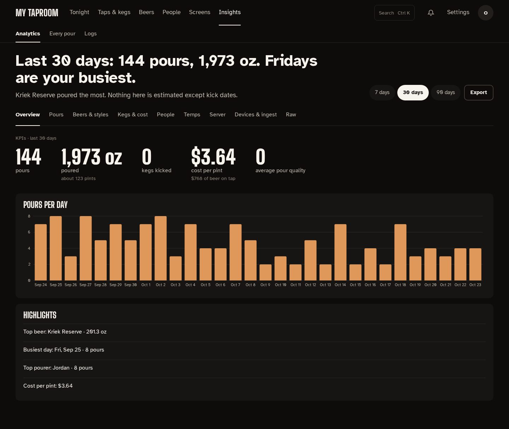

# Insights

**Insights** in the admin top bar has three tabs: **Analytics**, **Every pour** and **Logs**.

## Analytics

The page opens with a sentence about the chosen range ("Last 30 days: 141 pours, 1,942 oz.
Thursdays are your busiest.") and which beer poured the most. **7 days**, **30 days** and
**90 days** change the range for everything on the page; **Export** downloads the figures as
JSON.

The tabs:

| Tab | What it shows |
| --- | --- |
| Overview | Pours, volume (with about how many pints), kegs kicked in the range (by the day each keg was kicked), cost per pint (owners only) and average pour quality, then pours per day and a few highlights |
| Pours | When people pour (a day × hour heatmap), pours by hour, and every pour in the range |
| Beers & styles | Volume by beer, and each beer's history: first tapped, kegs, total, rating, how many pours were claimed |
| Kegs & cost | Each keg on tap and when it should kick; for admins, what each keg cost, cost per pint, value left and monthly spend |
| People | The leaderboard (this week, month or all time) and each pourer's history |
| Temps | Every temperature sensor's trend and 7-day range |
| Server | This server's CPU, memory and disk over the last day |
| Devices & ingest | Each source's state and UDP packet coverage per Kegtron |
| Raw | Each dataset as a CSV download; cost datasets for admins only |

A figure with no data shows **—**, never 0, with a line saying why: average pour quality reads
"—, no Kegtron quality data yet" until a Kegtron reports quality scores.

## Every pour

Every recorded pour, newest first, with a sentence saying how many of tonight's pours have no
name. Filter by **Unclaimed only**, a drinker, or a date range; change the name on a row, or tick
several rows and **Assign** them to one person. See
[Cleaning reminders and unclaimed pours](cleaning-and-pours.md#the-pours-page).

## Logs

A live log of what Kegwall did: pours, sources, walls, the kiosk, automations and changes made in
the admin. The sentence counts problems (warnings and errors) in the range. Search, pick a range
(last hour, 24 hours, 7 days or 30 days), filter by source and level, and **Follow live** to keep
new lines coming. **Export JSON** and **Export CSV** download what's shown. An error that repeats
offers **show similar**; lines with more detail open with **details**.
