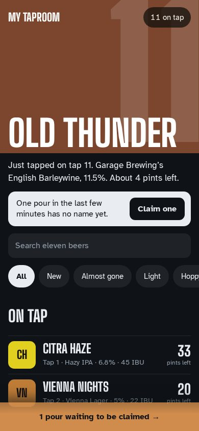
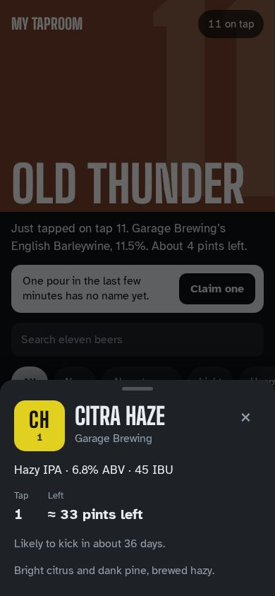
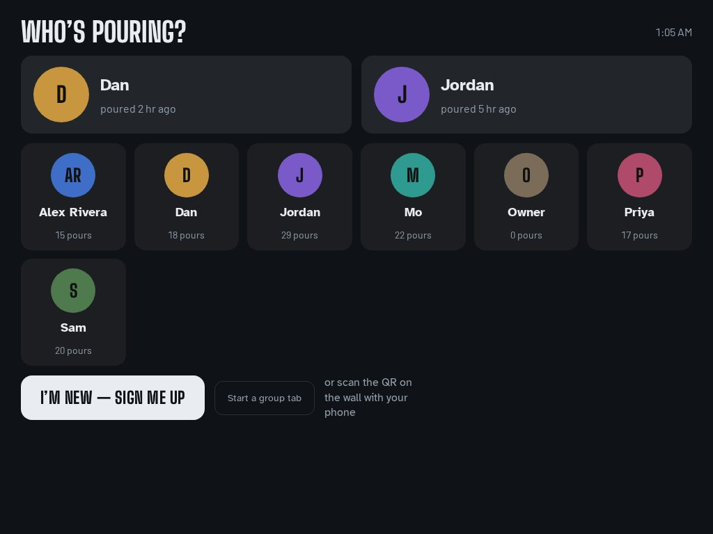
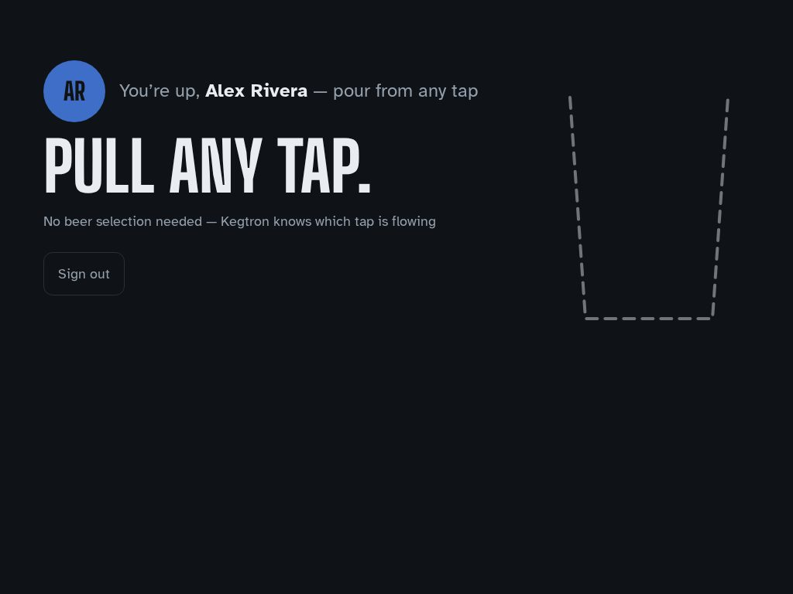
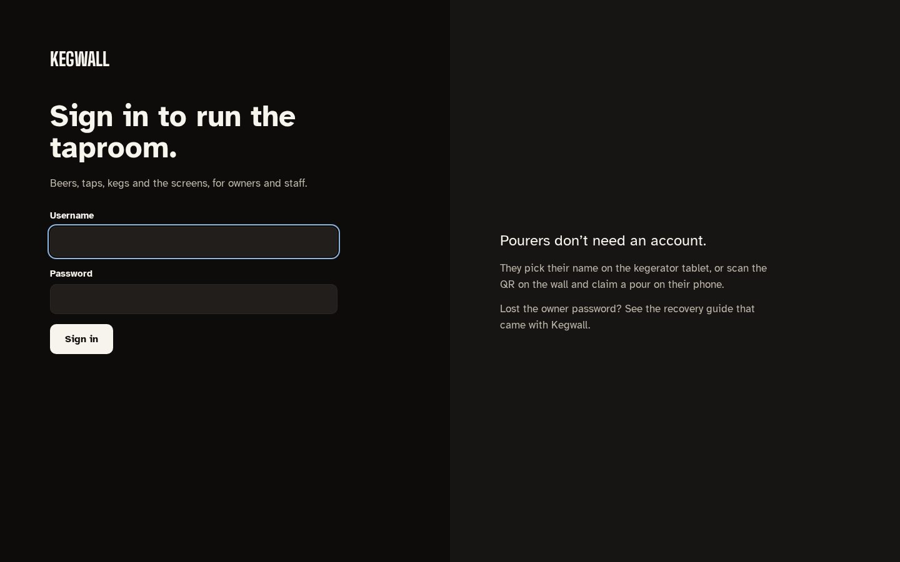

# The phone menu, the kiosk and signing in

Three screens guests and staff touch: the **phone menu** a guest opens from the wall's QR code,
the **kiosk** on the kegerator tablet where pourers pick their name, and the admin's
**sign-in and first-run setup**.

## The phone menu (`/menu`)

 

- **The newest keg leads.** A keg tapped in the last week fills the top of the page in its own
  color, with a sentence about it ("Just tapped on tap 11. Garage Brewing's English Barleywine,
  11.5%. About 4 pints left.").
- **Search and chips.** Search matches the beer's name, brewery and style. The chips are **All**,
  **New** (tapped this week), **Almost gone** (15% or less) and the style families on tap right
  now: **Light**, **Hoppy**, **Dark** and **Sour**, worked out from each beer's style (ciders and
  meads sit in no family; they're always under All).
- **One row per beer.** The name on its own line, then tap · style · ABV · IBU, the beer's tap
  marker, and pints left (in the taproom's serving size). A tap pouring right now says so.
- **The beer sheet.** Tapping a row opens a sheet with the beer's marker, style, ABV and IBU, the
  tap and what's left, the kick forecast, its average rating, the description, and the tap's own
  unclaimed pours as **That was me** rows. Escape, the × or the backdrop close it; keyboard focus
  stays inside while it's open.
- **Claiming a pour.** When pours are waiting for a name, a sentence near the top and a bar along
  the bottom say how many; either opens the picker. Claims work for 10 minutes after the pour
  (see [cleaning-and-pours.md](cleaning-and-pours.md#guest-claims-on-the-menu)). After a claim the
  guest can rate the pour with 48 px stars.
- **Passport.** A phone that has claimed a pour remembers the pourer; their **Passport** chip in
  the header jumps to their stats.

Every control on the menu is at least 44 px tall, checked by `tests/e2e/touch.spec.ts`.

## The kiosk (`/tablet/:wall`)

 

- **Who's pouring?** The two people who poured most recently as big tiles, then everyone as
  64 px avatars on 132 px tiles. Past eight pourers a 56 px search appears; past twelve, an A–Z
  rail. **I'm new — sign me up** asks only for a name and a color.
- **Armed, pouring, done** are one screen: the pourer and an instruction on the left, a glass on
  the right. Armed shows an empty dashed glass and "Pull any tap." When the Kegtron reports a
  flow, the glass fills with the measured volume and the counter runs. When the pour is recorded
  the screen shows the recorded volume and signs out after 5 seconds (tap to stay).
- If the tablet can't get the taps ready for a pourer, it says so instead of leaving them on the
  grid to guess.
- **Group tabs.** **Start a group tab** keeps a running total for everyone who signs in until it's
  ended (unchanged).

## Signing in and first-run setup

`/admin/login` and the first-run screens use the admin look (dark, or light when the device
prefers it) without the top bar. First run is one sequence with a progress bar: **create the
owner account** (`/admin/setup`, which needs the setup token printed in the server log on first
start), then name the taproom, connect Kegtron, Home Assistant, put the wall on a screen, and
choose how updates install (`/admin/welcome`).
