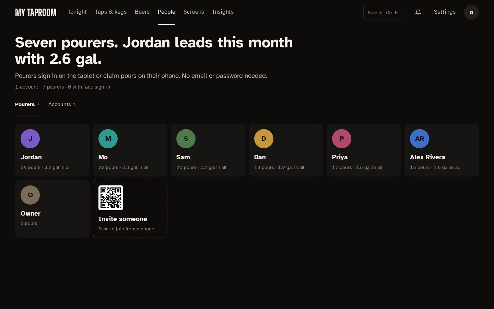

# People

**People** in the admin top bar has two tabs: **Pourers** for everyone (editors and viewers
see this one) and **Accounts** for admins.

The page opens with a sentence naming this month's leader ("Seven pourers. Jordan leads this
month with 3.2 gal."), with the number of accounts, pourers and people using face sign-in under
it.

## Pourers

Pourers don't have a password. They join from the kegerator tablet or from the menu QR on their
phone, then sign in on the tablet (or claim pours on their phone) to put their name on a pour.
Each card shows the pourer's pours and their volume in all, most volume first, plus the average
pour quality when the Kegtron reports one. The last card is the invite QR: it opens the phone
menu, where someone new can join.

## Accounts

Everyone on record, with what they can do:

| Role | Can |
| --- | --- |
| Admin | Everything, including costs and settings |
| Editor | Run taps, beers and walls. No costs or settings |
| Viewer | Look, but change nothing |
| No login | A pourer only: claims pours and appears on the leaderboard |

**Add someone** asks whether you're adding **an account** (username, display name, a password
of at least 8 characters, and a role) or **a pourer** (a name and a color). **Edit** changes the
name and color, and for an account the role and, optionally, the password. **Delete** asks
first; a deleted pourer's past pours stay on record without their name, and the last admin
can't be deleted.

A pourer who enrolled their face for [face sign-in](setup/face-sign-in.md) shows how many face
samples are stored, with **Delete face data**.

`/admin/users` and `/admin/pourers` still open these lists on their own.
