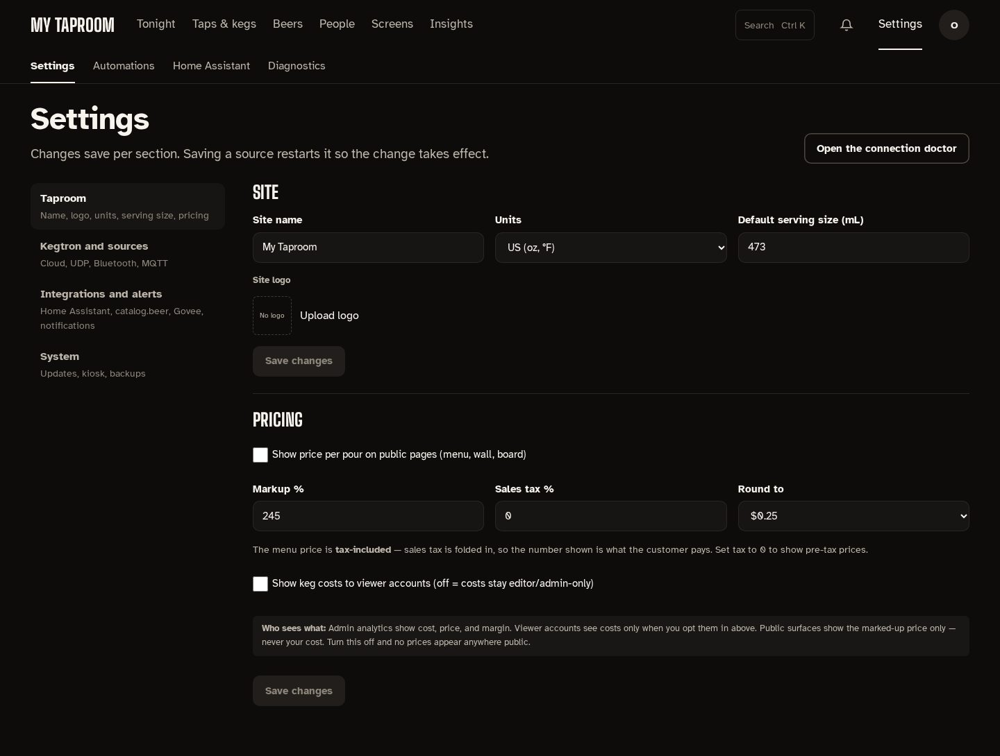

# Settings

**Settings** (admins) sits at the right of the admin top bar. Its tabs are **Settings**,
**Automations**, **Home Assistant** and **Diagnostics**; editors and viewers see Automations
only.

## Settings

The sections are listed down the left, each with a line on what it holds:

| Section | What's in it |
| --- | --- |
| Taproom | Site name, units, default serving size, logo; pricing (markup, tax, rounding, who sees costs) |
| Kegtron and sources | Kegtron cloud API key, UDP, Bluetooth and MQTT sources |
| Integrations and alerts | Home Assistant, catalog.beer, Govee, face sign-in, and notification channels (email, push, webhooks, MQTT) |
| System | App and OS updates, kiosk restart, a test pour, backups and restore |

Each block saves on its own, so unsaved changes elsewhere are kept. "Saved." appears briefly in
the corner; saving a source restarts it, and the corner says so. Addresses such as
`/admin/settings?tab=system` open a section directly.

## Automations

Each rule reads as one sentence, such as "When a keg drops below 15%, notify in the app.", with
its state beside it: **On**, **Off**, or **Just ran** in the five minutes after it fired, and when
it last ran. The switch turns a rule on or off; **Edit** opens the builder and **Delete** asks
first. **New rule** starts from a template (fill in the blanks) or a blank rule.

## Home Assistant

A guided setup that connects Kegwall to your MQTT broker so taps and monitors appear in Home
Assistant. See [Home Assistant](setup/home-assistant.md).

## Diagnostics

The connection doctor. The page's sentence is its verdict ("All 3 ingest paths healthy." or which
are down), then each source's state and checks that talk to the real service: the Kegtron cloud,
a 10-second UDP listen with history and raw packets, Govee, and how the network is set up. **Run
all checks** runs them together; every result is also written to Logs.

## Notifications

Behind the bell, and at `/admin/notifications`: every alert, newest first, with how many are
unread. Mark one or all as read.
