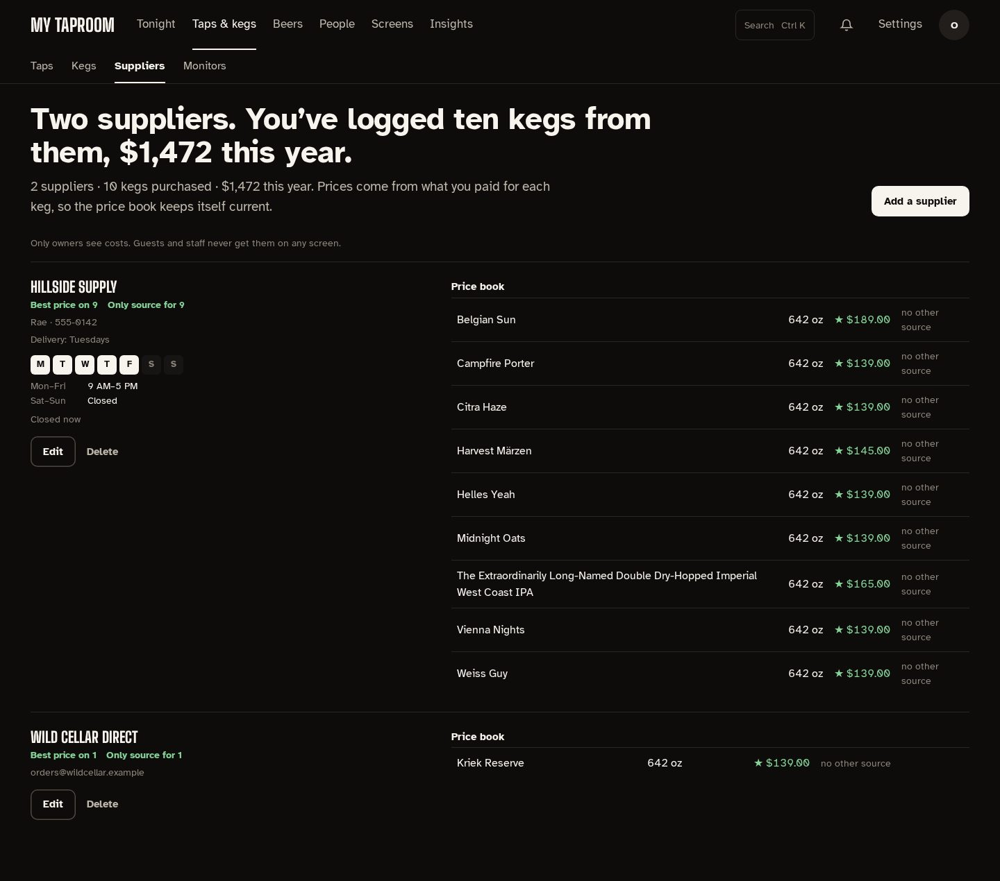

# Suppliers

The **Suppliers** tab under **Taps & kegs** (admin role) is the directory of the places you buy kegs from, plus a
price book derived automatically from what you've actually paid. It lives entirely behind
the admin login: it shows owner cost, which never reaches a public surface.

## The directory

The page opens with a sentence counting your suppliers and what you've logged from them this
year. Each supplier is one entry in the list: contact details (contact person, phone, email,
address, delivery day/notes) and the weekly opening hours on the left, the derived price book on
the right. **Add a supplier** and **Edit** open the form in a drawer. Deleting a supplier asks
first, and keeps the purchase history on its kegs — only the link to the supplier clears.

## Opening hours

Hours are entered as a **weekly grid**, one row per day, because most suppliers don't keep
the same hours all week:

- Tick a day to open it, then set its opening and closing time. Untick it for **Closed**.
- **Copy to all** stamps that day's times across the whole week — the fast path when five
  weekdays are identical, after which you fix up the weekend.
- The **Hours note** underneath is a free-text line for the things a grid can't express:
  "call ahead", "closed public holidays".

Each supplier shows the week as seven day letters with the open days filled in, then the days
that share the same hours on one line each (`Mon–Fri 9 AM–5 PM`, `Sat–Sun Closed`), and **Open
now** / **Closed now** so you know at a glance whether it's worth phoning. That reads the
browser's clock, so it's correct for whoever is looking.

Suppliers created before structured hours existed keep whatever text was typed in the old
single Hours field; it shows as the hours note (with no open or closed state, since there's no
structured week to judge). Filling in the grid replaces it.

## The price book

The price book is never typed in. It's read straight out of keg purchase history — every keg
you record with a supplier and a cost contributes one row per beer and size, showing the most
recent price you paid, and what the cheapest other supplier charged for it. Rows are flagged:

- **★** (best price) — no other supplier has sold you that beer and size cheaper.
- **no other source** — nobody else has sold it to you at all.

Under each supplier's name, **Best price on N** and **Only source for N** count those rows. The
line under the page's sentence sums it up: supplier count, kegs purchased, and this year's
spend.

## Who can see keg costs

Owner cost (what you paid for a keg, the deposit, the supplier, the purchase date) is
private by default:

- **Public surfaces** (wall, menu, board, guest phones) **never** see cost — at most the
  marked-up display price, and only when pricing is enabled. This is a hard rule with no
  toggle.
- **Editor and admin accounts** always see costs — editors record them, admins analyze them.
- **Viewer accounts** don't see costs by default: keg lists, the on-deck queue, and the
  money KPIs on Analytics (cost per pint, value on tap) come back with cost fields blank.
  If you want read-only accounts to see them, opt in at **Settings → Taproom → Pricing → "Show keg
  costs to viewer accounts"**.

## See also

- [docs/setup/kegtron-cloud.md](setup/kegtron-cloud.md) — devices and sensors.
- [CONTRIBUTING.md](../CONTRIBUTING.md) — the docs/changelog/wiki rule.
