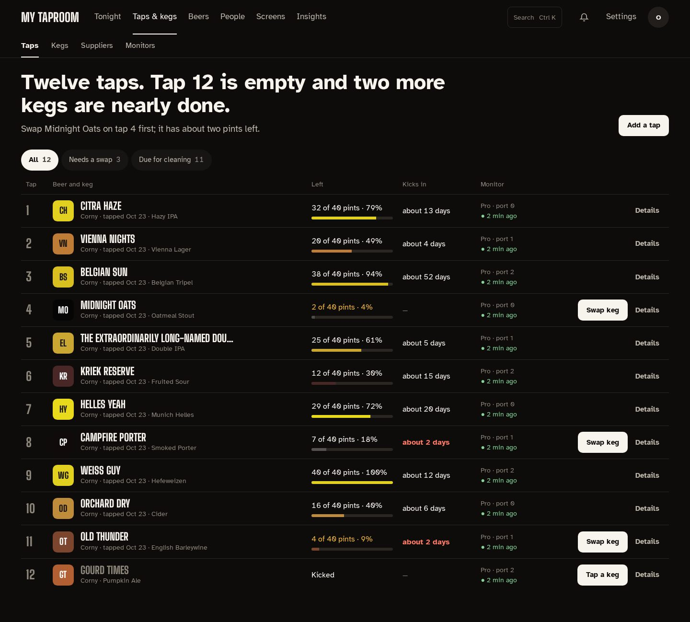
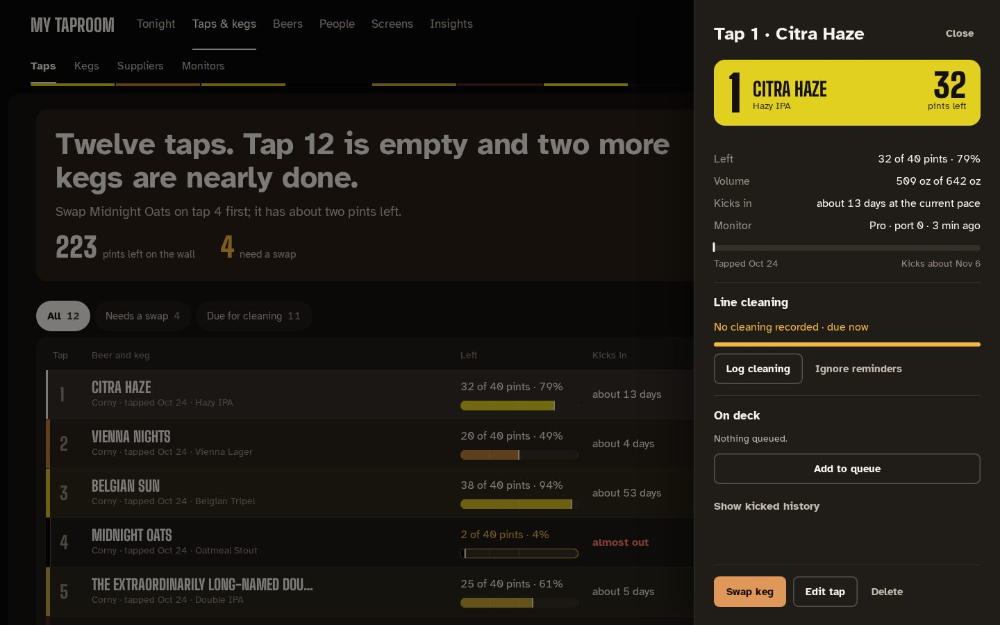
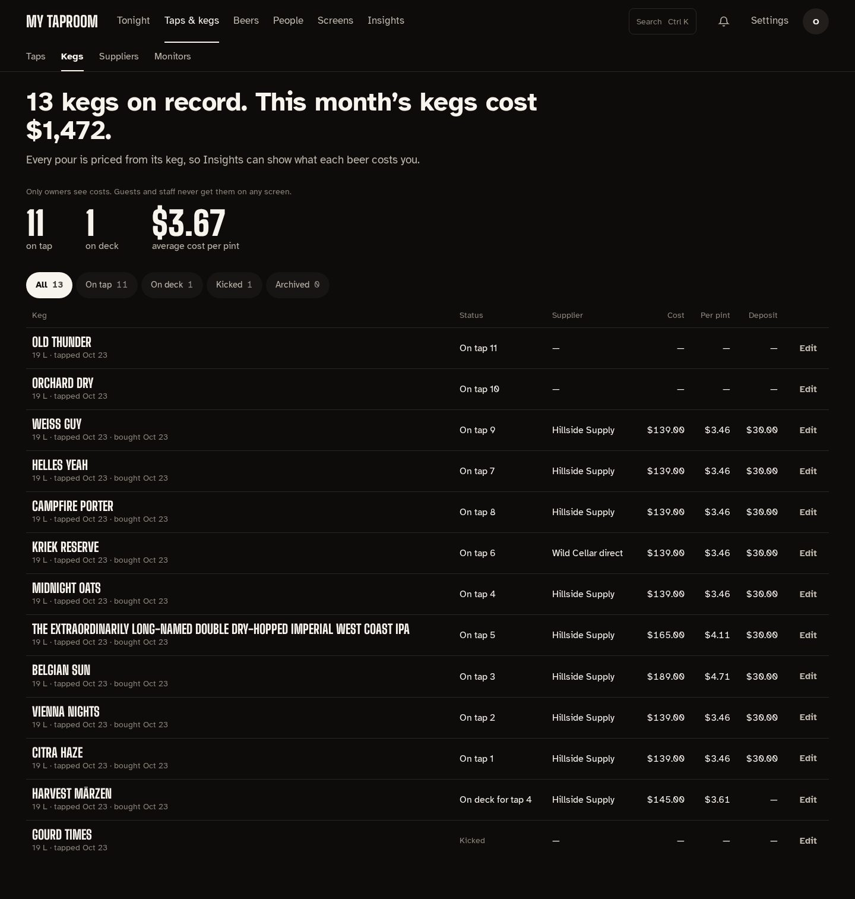
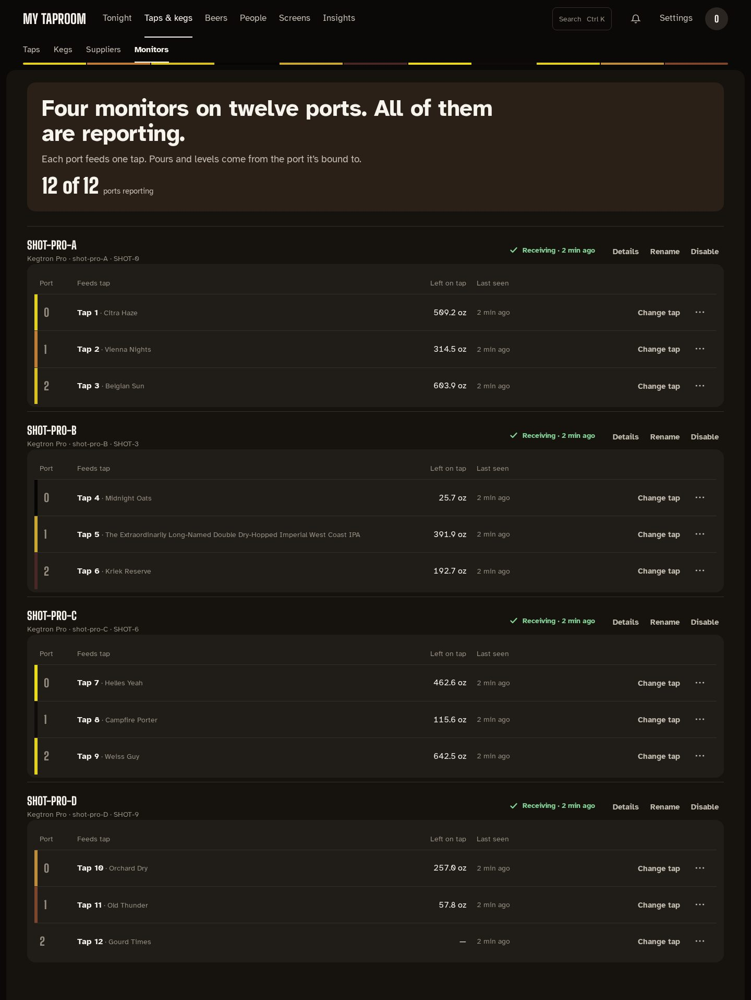

# Taps & kegs

**Taps & kegs** in the admin top bar has four tabs: **Taps**, **Kegs**, **Suppliers** and
**Monitors**. Kegs and Suppliers show owner cost and are for admin accounts only; editors and
viewers see Taps and Monitors.

## Taps

The page opens with a sentence about your taps ("Twelve taps. Tap 12 is empty and two more kegs
are nearly done.") and which keg to swap first. Under it, chips filter the list: **All**,
**Needs a swap** (empty, kicked, at 15 % or less, or projected to kick within three days: every
tap with a **Swap keg** button) and **Due for cleaning**. A nearly empty keg with no recent pours
has no pace to forecast from, so its **Kicks in** column reads "almost out".

Each row shows:

| Column | What it shows |
| --- | --- |
| Tap | The tap number |
| Beer and keg | The tap marker (the beer's color and initials), the beer, and the tap name, keg type, the day it was tapped and the style |
| Left | Servings left of a full keg in your serving size ("20 of 40 pints · 50 %"), and a bar in the beer's color. Amber when the keg is low |
| Kicks in | The projected kick at the current pace; red when it's within three days |
| Monitor | The Kegtron port feeding the tap and when it last reported |

Levels update live, the same way the wall does. **Swap keg** appears on rows that need one;
**Details** opens the tap's drawer.

### A tap's drawer

Select **Details** (or follow a tap from Tonight) to open the tap's drawer on the right:

- what's left, in servings and volume, the kick forecast and the bound monitor, with a timeline
  from the day it was tapped to the projected kick;
- **Line cleaning**: days and gallons since the last cleaning, a meter toward the next one,
  **Log cleaning** (now, yesterday or a date you pick) and **Ignore reminders** / **Resume
  reminders**. See [Cleaning reminders and unclaimed pours](cleaning-and-pours.md);
- **On deck**: kegs queued for this tap, with **Tap next** (or **Swap now** when the current keg
  is about to kick), **Remove** and **Add to queue**;
- **Show kicked history**: the tap's last kicked kegs;
- **Swap keg**, **Edit tap** and **Delete** along the bottom (editors and admins).

Addresses such as `/admin/taps?tap=4` open that tap's drawer directly.

### Swapping a keg

**Swap keg** opens the swap in a drawer, with its steps listed at the top:

1. **Kick the old keg** (when one is on). The kicked keg and its pours stay in history.
2. **Choose the beer.** The first choices are the tap's **next up** keg from the on-deck queue
   and **another keg of the same beer**; under them, search the beer library, add a new beer, or
   import the beer a bound Kegtron Pro already knows.
3. **Keg size**: size, starting volume (lower it for a partly used keg) and keg type, prefilled
   from the Kegtron device or the beer's last keg.
4. **Cost** (optional, owners only): cost, deposit, supplier and purchase date, with the cost
   per pint. **Skip** taps the keg without it.
5. **Reset the counter**: when the tap's monitor is a Kegtron Pro, reset its on-device volume
   counter to match the new keg. This changes the real device.

Choosing the next-up keg taps that queued keg as it is, so the size and cost steps are skipped.
Escape, **Close** or **Cancel** leaves without changing anything until a step's own button runs.

## Kegs

Every keg on record, on tap or not, with what it cost. The sentence counts the kegs and totals
this month's keg costs; under it, the number on tap and on deck and the average cost per pint
("—" until a cost is logged). Chips filter by status: **All**, **On tap**, **On deck**,
**Kicked** and **Archived**.

The table lists each keg's size and dates, its status, supplier, cost, cost per pint and deposit.
**Edit** opens a drawer to set the cost, deposit, supplier and purchase date after the fact.

## Suppliers

See [Suppliers](suppliers.md).

## Monitors

One section per physical device: a Kegtron Pro (up to four ports), a Kegtron Gen 1, or a Govee
sensor. Each says where its state comes from: **Receiving** with the time of the last report,
**Not heard from** when nothing has arrived for 10 minutes, or **Disabled**. The sentence at the
top counts the devices and ports and names any that have gone quiet; the line under it counts
ports that aren't bound to a tap.

Under each Kegtron, a table maps each port to the tap it feeds, with what's left on that tap and
when the port last reported. **Bind a tap** / **Change tap** picks the tap, **Unbind** clears it,
and **Reset volume** (Kegtron Pro) resets that port's on-device counter after a confirmation.

**Details** opens the device's drawer: firmware and Kegtron cloud state, **Check WiFi signal**
(asks the device, so it runs only when you press it) and the last 24 hours of temperature and
humidity. **Rename** gives the device a friendly name. **Disable** is for hardware at another
location: the device stays listed but stops feeding pours, levels and readings until you
**Enable** it again.

Viewers see all of this without the controls.
